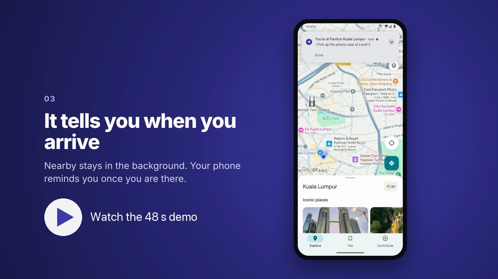
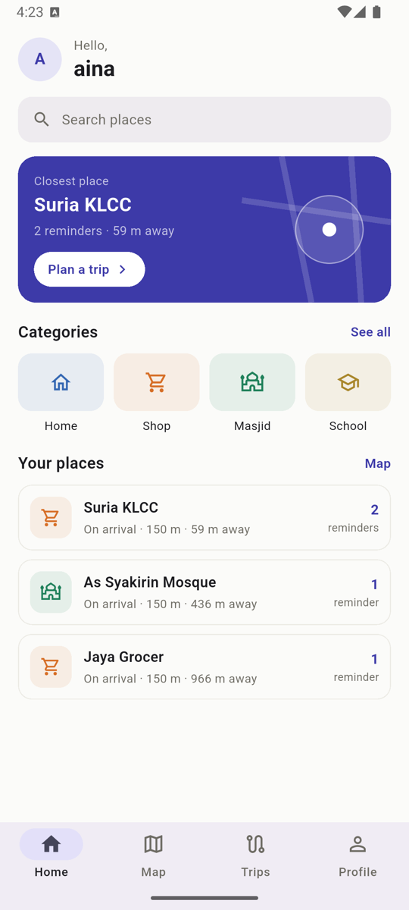
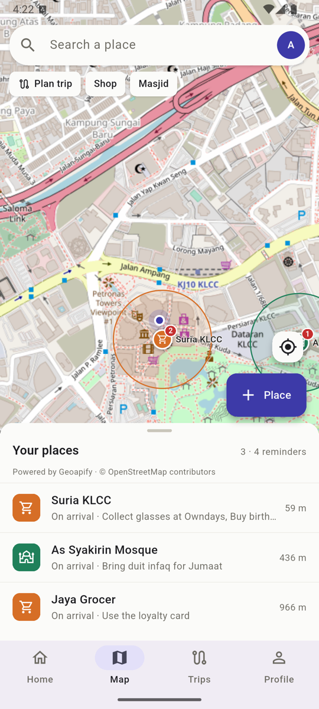
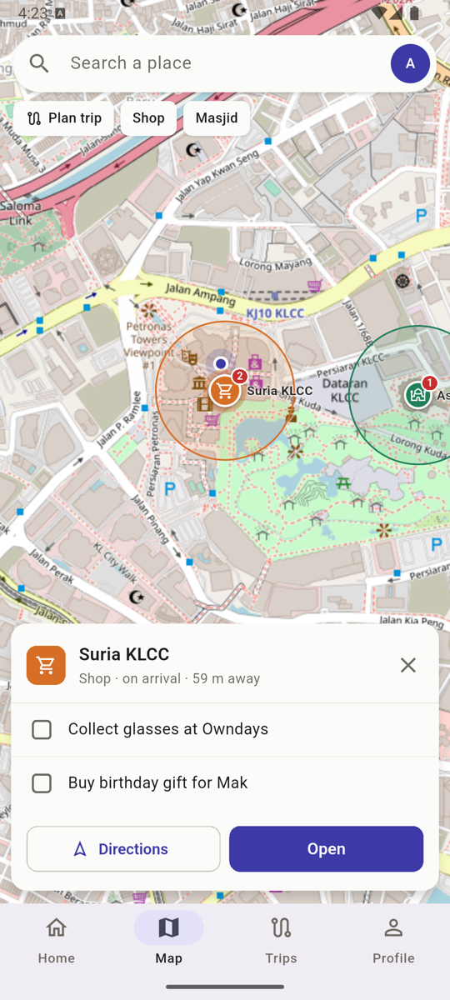
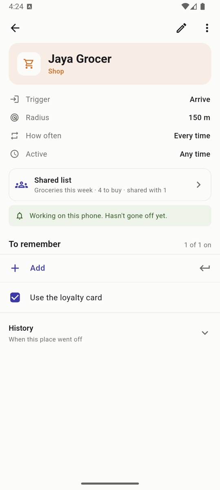
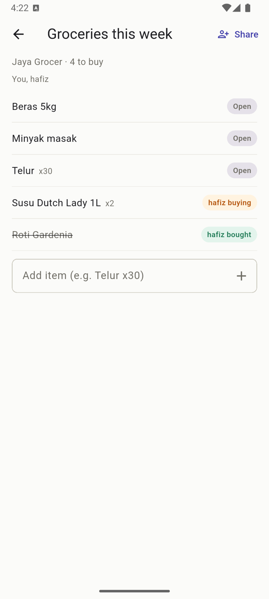
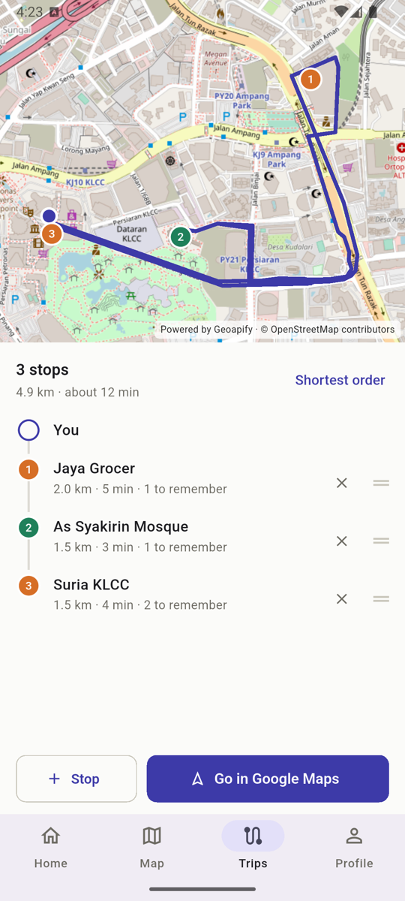

# Nearby

A location reminder app. Save a place, add a few things to remember there,
and your phone tells you when you arrive. Built with Flutter and Supabase.

## What it does

- Search for a place or tap the map to pin one
- Set a radius and pick when to remind: arrive, leave or stay a while
- Add a checklist of reminders per place
- Get a notification when you reach the place, even with the app closed
- Tap the notification to open that place, or press Done to tick it off
  without opening the app
- Plan a trip across saved places, with the shortest order and per-leg
  distance and time, then hand it off to Google Maps
- Works offline. Everything is saved on the phone first and syncs to
  Supabase when there's a connection
- Add friends by username and share a shopping list on a place. Friends who
  can buy see it live, claim items, and get the alert when they pass by

## Demo

48 seconds: saving a place, the arrival alert, a shared list and the trip planner. Recorded on the Android emulator with a demo account.

## Download

Get the latest APK from [Releases](https://github.com/syaheerdnl/nearby/releases/latest). Android only.

## Screenshots

<table>
  <tr>
    <td></td>
    <td></td>
    <td></td>
  </tr>
  <tr>
    <td>Home: closest place and your list of places</td>
    <td>Map: each place with its reminder area</td>
    <td>Tap a pin to see and tick off reminders</td>
  </tr>
  <tr>
    <td></td>
    <td></td>
    <td></td>
  </tr>
  <tr>
    <td>Place settings, reminders and its shared list</td>
    <td>Shared list: a friend claims and buys items, updated live</td>
    <td>Trip planner: shortest order across saved places</td>
  </tr>
</table>

## How it works

Arrival detection uses the phone's own geofencing (Android geofencing API
through `native_geofence`), not a loop polling GPS in Dart. The OS wakes the
app in the background when you cross a place's edge. The app reads the
place from the local SQLite database, shows the notification and logs the
visit. No network call is needed at that point.

Edits go into SQLite with a sync flag and get pushed to Supabase later.
Pulls never overwrite a row that still has local changes waiting.

## Stack

| Part | Used |
|---|---|
| App | Flutter, Provider |
| Map | flutter_map, Geoapify tiles (OpenStreetMap data) |
| Geofencing | native_geofence |
| Local storage | sqflite |
| Backend | Supabase (Auth, Postgres, row level security) |
| Search / routing | Geoapify Autocomplete, Routing, Route Matrix |
| Notifications | flutter_local_notifications |

## Testing

`tools/geofence_test.sh` drives the Android emulator's GPS from 2 km out
into a saved place and checks the geofence fires and the notification
shows. On the emulator it fires about 10 s after crossing in.

## Run it

1. Create a Supabase project and run the SQL in `supabase/` in order
2. Copy `config.example.json` to `config.json` and fill in your Supabase
   URL and publishable key, plus a Geoapify API key (free plan). Without
   the Geoapify key the app falls back to the public OSM, Photon and OSRM
   demo servers, which are fine for development only
3. `flutter run --dart-define-from-file=config.json`

Android only for now. iOS setup isn't done yet.
